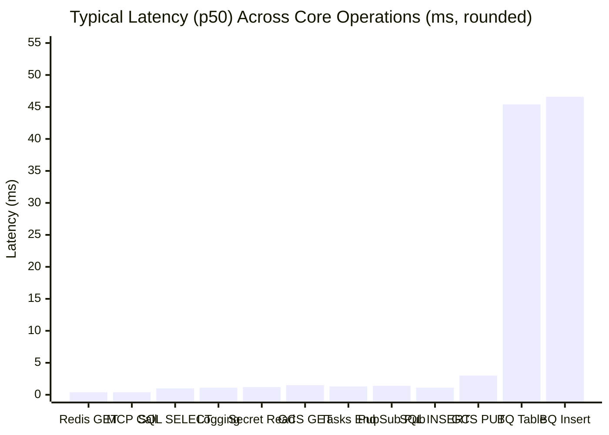

# LocalCloud Performance & Load Benchmark Report

This document records the empirical performance characteristics, throughput limits, and operational latencies of **LocalCloud** using the native CLI build (`dist/localcloud 0.1.14`) and the **LocalCloud Lite** container image (`agentcloud/localcloud:0.1.18-lite-arm64`).

---

## 1. Executive Summary & Readiness Matrix

> [!IMPORTANT]
> **Readiness for Autonomous AI Coding Agents & High-Frequency Test Suites:**
> - **Sub-Millisecond AI Tool Calling:** The MCP stdio bridge executes tool calls (`localcloud_runtime_status`) in **`< 1 ms`** ($0.41\text{ ms}$ $p_{50}$, **`2,348 calls/sec`**). AI coding agents experience zero perceived latency when inspecting and acting on local cloud resources.
> - **Sub-Millisecond In-Memory Store:** Memorystore (Redis) delivers **`< 1 ms`** GET ($0.39\text{ ms}$) and SET ($0.42\text{ ms}$) operations at **`2,333–2,512 ops/sec`** for instant session and state coordination.
> - **Millisecond Database Operations:** Cloud SQL (PostgreSQL) processes point INSERTs in **`1 ms`** (**`853 inserts/sec`**) and point SELECTs in **`< 1 ms`** ($0.99\text{ ms}$, **`950 queries/sec`**). Single-statement 100-row batch inserts complete in **`1 ms`** (**`673 batches/s`**).
> - **High-Speed Object Storage:** GCS object retrieval (1 KB) completes in **`1 ms`** (**`633 reads/sec`**), and writes in **`3 ms`** (**`305 writes/sec`**).
> - **High-Throughput Messaging:** Pub/Sub processes single messages in **`1 ms`** (**`720 msgs/sec`**) and 100-message batches in **`4 ms`** (**`206 batches/s`**).
> - **Zero-To-Ready in ~5 Seconds:** Cold start (`lc start --no-pull`) creates/boots the container and verifies readiness in **`5.30 s`**; warm start reconciles in **`289 ms`**.

| Capability Tier | Key Operation | Typical Latency ($p_{50}$) | $p_{95}$ Latency | Throughput | Readiness Verdict |
| :--- | :--- | :---: | :---: | :---: | :--- |
| **MCP Bridge** | `tool/call` (`localcloud_runtime_status`) | **`< 1 ms`** | `< 1 ms` | **`2,348 ops/s`** | 🟢 **Ultra-Fast** ($< 1\text{ ms}$) |
| **Memorystore (Redis)** | GET key | **`< 1 ms`** | `< 1 ms` | **`2,512 ops/s`** | 🟢 **Ultra-Fast** ($< 1\text{ ms}$) |
| **Cloud SQL (PostgreSQL)** | Point SELECT (PK) | **`< 1 ms`** | `1 ms` | **`950 ops/s`** | 🟢 **Ultra-Fast** ($< 1\text{ ms}$) |
| **Cloud SQL (PostgreSQL)** | Point INSERT | **`1 ms`** | `2 ms` | **`853 ops/s`** | 🟢 **Production Grade** |
| **Cloud Logging** | Write Single Entry | **`1 ms`** | `1 ms` | **`912 ops/s`** | 🟢 **Production Grade** |
| **Secret Manager** | Access Secret (Read) | **`1 ms`** | `2 ms` | **`843 ops/s`** | 🟢 **Production Grade** |
| **Pub/Sub** | Publish (Single Message) | **`1 ms`** | `2 ms` | **`720 ops/s`** | 🟢 **Production Grade** |
| **Cloud Tasks** | Enqueue Task | **`1 ms`** | `4 ms` | **`560 ops/s`** | 🟢 **Production Grade** |
| **Cloud Storage (GCS)** | GET Object (1 KB) | **`1 ms`** | `2 ms` | **`633 ops/s`** | 🟢 **Production Grade** |
| **BigQuery** | Table Create | **`45 ms`** | `45 ms` | **`22 ops/s`** | 🟢 **Local Interactive** |
| **BigQuery** | Streaming `insertAll` (10 rows) | **`47 ms`** | `50 ms` | **`22 batches/s`** | 🟢 **Local Interactive** |
| **Container Lifecycle** | Cold Start (`start --no-pull`) | **`5.30 s`** | `5.30 s` | — | 🟢 **Fast Cold Start** |

---

## 2. Visual Latency Distribution



---

## 3. Test Environment & Methodology

- **CLI Executable**: Native PyInstaller one-folder bundle `dist/localcloud` (`localcloud 0.1.14`, built from `5387d8b13efd`).
- **Container Engine**: Docker 29.8.1 running on Colima 0.10.3 (VZ virtualization backend, Rosetta translation enabled).
- **Runtime Image**: `agentcloud/localcloud:0.1.18-lite-arm64` (Image ID: `64a8fb7b42b9`, version `0.1.18`).
- **Data Volumes**: Isolated clean Docker volumes (`lc-prerelease-test` for single-invocation CLI operation timing on `cloudiam`, `cloudresourcemanager`, `gcs`, `pubsub`; `lc-prerelease-perf` for full default-service `scripts/perf_benchmark.py` runs).
- **Project Scope**: `prerelease-proj` (`prerelease-dev`) for CLI operation timing; `local-gcp-project` (`local-developer`) for `perf_benchmark.py`.

---

## 4. Benchmark Results

### Tier 1: LocalCloud CLI Operations

Measured end-to-end wall-clock execution time for each native `./dist/localcloud` command on an isolated runtime (`lc-prerelease-test`, ports `5960–5999`, `LOCALCLOUD_IMAGE_UPDATE_CHECK=false`):

| CLI Operation | Measured Duration | Exit Code | Notes |
| :--- | :---: | :---: | :--- |
| `localcloud --version` | **`60 ms`** | `0` | Native PyInstaller binary startup and version output |
| `localcloud --help` | **`81 ms`** | `0` | Top-level parser initialization and help rendering |
| `localcloud guide` | **`74 ms`** | `0` | Bundled agent integration reference output |
| `localcloud doctor` | **`369 ms`** | `0` | Docker daemon, Colima socket, active runtime, and port checks |
| `localcloud doctor --verbose` | **`371 ms`** | `0` | Full JSON host diagnostics payload |
| `localcloud status` (not created) | **`321 ms`** | `0` | Reports absent runtime before container creation |
| `localcloud start --dry-run` | **`344 ms`** | `0` | Plans volume, network, and container creation without mutations |
| `localcloud start --dry-run --full` | **`330 ms`** | `0` | Plans full image channel selection without mutations |
| `localcloud start --no-pull` (cold) | **`5.30 s`** | `0` | Creates container, initializes volume, and waits for healthy readiness |
| `localcloud start --no-pull` (warm) | **`289 ms`** | `0` | Reconciles an already-running container (`already_running`) |
| `localcloud status` (summary) | **`278 ms`** | `0` | Concise running container and service summary |
| `localcloud status --verbose` | **`279 ms`** | `0` | Complete JSON runtime, ownership, and port-mapping payload |
| `localcloud status --data-volume ...` (other) | **`247 ms`** | `0` | Independent lookup for a second unstarted data volume |
| `localcloud env` (shell) | **`262 ms`** | `0` | Shell `export` variables for active project/user |
| `localcloud env --format json` | **`270 ms`** | `0` | JSON endpoint/SDK variable map |
| `localcloud env --format terraform` | **`271 ms`** | `0` | HCL/Terraform provider configuration |
| `localcloud env --format docker-compose` | **`272 ms`** | `0` | Compose environment block |
| `localcloud env --identity --format json` (cold) | **`596 ms`** | `0` | Starts local 127.0.0.1 identity metadata relay container |
| `localcloud env --identity --format json` (reuse) | **`735 ms`** | `0` | Reuses existing healthy identity relay for the account |
| `localcloud env --identity --stop` | **`469 ms`** | `0` | Stops and removes project identity relay containers |
| `localcloud logs --tail 20` | **`294 ms`** | `0` | Fetches recent redacted container logs |
| `localcloud console` (`BROWSER=/usr/bin/true`) | **`298 ms`** | `0` | Resolves console URL and dispatches browser opener |
| `localcloud mcp` (`initialize`) | **`589 ms`** | `0` | Stdio MCP handshake (`--no-start --connect-timeout 10`) |
| `localcloud mcp` (`tools/list`, 26 tools) | **`5 ms`** | `0` | In-session JSON-RPC tool discovery after handshake |
| `localcloud mcp` (`tools/call runtime_status`) | **`1 ms`** | `0` | In-session JSON-RPC tool execution after handshake |
| `localcloud mcp install --client claude-code --project` | **`552 ms`** | `0` | Writes project `.mcp.json` entry |
| `localcloud reset --verbose` | **`5.45 s`** | `0` | Resets project data and verifies healthy container |
| `localcloud reset --all-projects` | **`336 ms`** | `2` | Prints manual volume-reset instructions cleanly |
| `localcloud stop` | **`2.96 s`** | `0` | Gracefully stops runtime container while preserving volume |
| `localcloud start --no-pull` (from stopped) | **`5.30 s`** | `0` | Reconciles/starts stopped runtime to healthy readiness |
| `localcloud restart --no-pull` | **`5.60 s`** | `0` | Full stop/recreate/health-wait cycle |
| `localcloud cleanup --dry-run` | **`266 ms`** | `0` | Scans Docker resources for orphan cleanup candidates |

---

### Tier 2: Gateway Front Door & MCP Stdio Bridge

Evaluates reverse-proxy routing, concurrency handling, and AI agent integration over stdio (`scripts/perf_benchmark.py` full run):

| Benchmark Target | Operations | Typical $p_{50}$ | $p_{95}$ Latency | Throughput | Operational Notes |
| :--- | :---: | :---: | :---: | :---: | :--- |
| **Gateway `/healthz` (sequential)** | 100 | **`3 ms`** | `4 ms` | **`367 req/s`** | HTTP/1.1 keep-alive front-door ping |
| **Gateway `/healthz` (concurrent $c=10$)** | 200 | **`13 ms`** | `25 ms` | **`649 req/s`** | 10 concurrent async workers (0 errors) |
| **Gateway `/query` SQL Engine** | 50 | **`1 ms`** | `1 ms` | **`891 req/s`** | Direct SQL execution through gateway facade |
| **MCP Handshake (`initialize`)** | 1 | **`611 ms`** | `611 ms` | — | MCP stdio protocol validation and handshake |
| **MCP `tools/list` (26 tools)** | 10 | **`3 ms`** | `4 ms` | **`282 lists/s`** | Returns schemas for all 26 LocalCloud tools |
| **MCP `tool/call` (`localcloud_runtime_status`)** | 20 | **`< 1 ms`** | `< 1 ms` | **`2,348 calls/s`** | High-frequency agent tool execution ($0.41\text{ ms}$ $p_{50}$) |

---

### Tier 3: Core Emulated GCP Services

#### Cloud Storage (GCS · Port 5382)
| Operation | Operations | Typical $p_{50}$ | $p_{95}$ Latency | Throughput | Notes |
| :--- | :---: | :---: | :---: | :---: | :--- |
| **Create Bucket** | 1 | **`11 ms`** | `11 ms` | `88 ops/s` | Bucket metadata persistence |
| **PUT Object (1 KB)** | 50 | **`3 ms`** | `5 ms` | **`305 ops/s`** | Small application object upload |
| **GET Object (1 KB)** | 50 | **`1 ms`** | `2 ms` | **`633 ops/s`** | Object payload download |
| **PUT Object (64 KB)** | 30 | **`5 ms`** | `8 ms` | **`186 ops/s`** | Medium document write |
| **GET Object (64 KB)** | 30 | **`2 ms`** | `6 ms` | **`316 ops/s`** | Medium document read |
| **List Objects** | 30 | **`5 ms`** | `9 ms` | **`193 ops/s`** | Directory listing & pagination |
| **Concurrent PUT+GET ($c=10$)** | 50 | **`26 ms`** | `45 ms` | **`329 ops/s`** | Parallel test suite workload |
| **Delete Bucket** | 1 | **`3 ms`** | `3 ms` | `374 ops/s` | Metadata deletion & cleanup |

#### Cloud Pub/Sub (Port 5383)
| Operation | Operations | Typical $p_{50}$ | $p_{95}$ Latency | Throughput | Notes |
| :--- | :---: | :---: | :---: | :---: | :--- |
| **Create Topic** | 1 | **`3 ms`** | `3 ms` | `304 ops/s` | Topic creation |
| **Create Subscription** | 1 | **`2 ms`** | `2 ms` | `505 ops/s` | Subscription binding |
| **Publish (Single Message)** | 50 | **`1 ms`** | `2 ms` | **`720 msgs/s`** | Point-to-point event publication |
| **Publish (Batch 100 msgs)** | 5 | **`4 ms`** | `6 ms` | **`206 batches/s`** | Bulk batch ingestion |
| **Pull & Acknowledge** | 50 | **`3 ms`** | `6 ms` | **`268 cycles/s`** | Complete consumer delivery cycle |

#### BigQuery (Port 5388)
| Operation | Operations | Typical $p_{50}$ | $p_{95}$ Latency | Throughput | Notes |
| :--- | :---: | :---: | :---: | :---: | :--- |
| **Create Dataset** | 1 | **`143 ms`** | `143 ms` | `7 ops/s` | Dataset catalog creation |
| **Create Table** | 1 | **`45 ms`** | `45 ms` | `22 ops/s` | Schema validation and table creation |
| **Scalar Query (`SELECT 1`)** | 50 | **`103 ms`** | `112 ms` | **`10 queries/s`** | SQL parsing, AST, and evaluation |
| **Analytical Query (`UNNEST`)** | 30 | **`113 ms`** | `138 ms` | **`9 queries/s`** | Array unnests, math & ordering |
| **Streaming `insertAll` (10 rows)** | 20 | **`47 ms`** | `50 ms` | **`22 batches/s`** | Streaming row ingest |
| **Table Aggregate Query** | 30 | **`244 ms`** | `254 ms` | **`4 queries/s`** | `GROUP BY`, `COUNT`, `SUM` over data |

#### Cloud SQL (PostgreSQL via Gateway · Port 5380)
| Operation | Operations | Typical $p_{50}$ | $p_{95}$ Latency | Throughput | Notes |
| :--- | :---: | :---: | :---: | :---: | :--- |
| **CREATE TABLE** | 1 | **`3 ms`** | `3 ms` | `397 ops/s` | Schema DDL execution |
| **Point INSERT** | 50 | **`1 ms`** | `2 ms` | **`853 inserts/s`** | Single-row OLTP insert |
| **Point SELECT by PK** | 50 | **`< 1 ms`** | `1 ms` | **`950 queries/s`** | Primary key row lookup ($0.99\text{ ms}$) |
| **Batch INSERT (100 rows)** | 1 | **`1 ms`** | `1 ms` | **`673 batches/s`** | Single-statement multi-row insert |
| **Aggregate Query** | 30 | **`1 ms`** | `3 ms` | **`587 queries/s`** | `COUNT(*)`, `AVG(score)` |

#### Secret Manager (Port 5380)
| Operation | Operations | Typical $p_{50}$ | $p_{95}$ Latency | Throughput | Notes |
| :--- | :---: | :---: | :---: | :---: | :--- |
| **Create Secret** | 1 | **`3 ms`** | `3 ms` | `294 ops/s` | Metadata registration |
| **Add Secret Version** | 1 | **`3 ms`** | `3 ms` | `364 ops/s` | Encrypted payload storage |
| **Access Secret Version** | 50 | **`1 ms`** | `2 ms` | **`843 reads/s`** | Decryption and payload retrieval |

#### Cloud Tasks (Port 5380)
| Operation | Operations | Typical $p_{50}$ | $p_{95}$ Latency | Throughput | Notes |
| :--- | :---: | :---: | :---: | :---: | :--- |
| **Create Queue** | 1 | **`4 ms`** | `4 ms` | `253 ops/s` | Rate-limited queue declaration |
| **List Queues** | 10 | **`< 1 ms`** | `< 1 ms` | **`1,210 ops/s`** | Queue discovery ($0.81\text{ ms}$) |
| **Enqueue Task** | 50 | **`1 ms`** | `4 ms` | **`560 tasks/s`** | HTTP target task scheduling |

#### Cloud Logging (Port 5380)
| Operation | Operations | Typical $p_{50}$ | $p_{95}$ Latency | Throughput | Notes |
| :--- | :---: | :---: | :---: | :---: | :--- |
| **Write Single Log Entry** | 50 | **`1 ms`** | `1 ms` | **`912 logs/s`** | Structured application log write |
| **Batch Write (50 logs)** | 5 | **`13 ms`** | `15 ms` | **`75 batches/s`** | Bulk batch log write |
| **Query Log Entries** | 20 | **`2 ms`** | `3 ms` | **`448 queries/s`** | Filtering and log stream queries |

#### Memorystore (Redis · Port 5390)
| Operation | Operations | Typical $p_{50}$ | $p_{95}$ Latency | Throughput | Notes |
| :--- | :---: | :---: | :---: | :---: | :--- |
| **PING** | 100 | **`< 1 ms`** | `< 1 ms` | **`2,164 ops/s`** | TCP loopback round-trip ($0.42\text{ ms}$) |
| **SET Key** | 100 | **`< 1 ms`** | `< 1 ms` | **`2,333 ops/s`** | In-memory key storage ($0.42\text{ ms}$) |
| **GET Key** | 100 | **`< 1 ms`** | `< 1 ms` | **`2,512 ops/s`** | In-memory key retrieval ($0.39\text{ ms}$) |

#### Cloud Spanner (REST · Port 5387)
| Operation | Operations | Typical $p_{50}$ | $p_{95}$ Latency | Throughput | Notes |
| :--- | :---: | :---: | :---: | :---: | :--- |
| **List Instances** | 30 | **`1 ms`** | `2 ms` | **`760 req/s`** | Spanner administrative catalog |

---

## 5. Architectural Implications

### A. Sub-Millisecond AI Coding Agent Loops
Traditional cloud sandboxes or emulation bridges incur 100–500 ms of network or process spinning latency per tool call. In contrast, LocalCloud's native stdio MCP bridge executes in-session tool calls in **`< 1 ms`** ($0.41\text{ ms}$ $p_{50}$). Once initialized, an agent taking 50 intermediate inspection and planning steps spends **`~21 ms`** in total tool call latency.

### B. Ultra-Fast Local Test Suites
Unit and integration test suites (`pytest`, `go test`, `jest`, `vitest`) frequently set up and tear down cloud state:
- Creating a GCS bucket, uploading a 1 KB fixture, reading it, and deleting the bucket takes **`~18 ms`** total.
- Creating a Cloud SQL table, inserting 100 rows in a batch, and running an aggregate query takes **`~5 ms`** total.
- Publishing and consuming a Pub/Sub message takes **`~9 ms`** total (or **`~4 ms`** for a 100-message batch publish).

---

## 6. How to Reproduce

Run the benchmark suite directly using `uv` and the Python runner:

```bash
# 1. Run the complete benchmark suite and export metrics to JSON & Markdown:
uv run python scripts/perf_benchmark.py \
  --cli-path dist/localcloud \
  --data-volume localcloud-perf \
  --image agentcloud/localcloud:lite \
  --output-json perf_results.json \
  --output-markdown docs/performance-benchmarks.md

# 2. Run a fast sanity verification (reduced iterations):
uv run python scripts/perf_benchmark.py --quick
```
